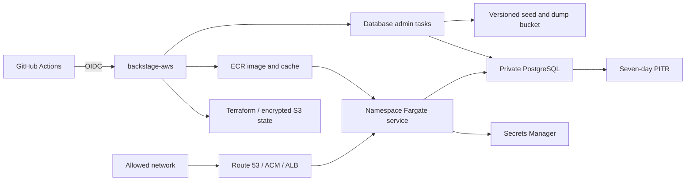

# Architecture

One Rust CLI orchestrates Terraform and AWS. Node lives only in the Backstage app; CI supplies tools and credentials.

## Four Terraform stacks

| Stack | Lifetime | Owns |
|---|---|---|
| `access` | Owner-managed account setup | Scoped Identity Center provisioner, workload boundary and provisioning policies |
| `bootstrap` | Account | State/KMS, GitHub OIDC role, optional account baseline/budget |
| `base` | Shared | VPC, ALB/TLS/DNS, ECS, ECR, RDS, secrets, seed/dump storage, admin tasks |
| `env` | Namespace | Target group, listener rule, log group, task definition, service |

Slow resources exist before PR deployment. State keys: `bootstrap/terraform.tfstate`, `base/terraform.tfstate`, `env/<namespace>.tfstate` in `<name>-<account>-<region>-tfstate`. Native S3 lockfiles serialize Terraform writers.

`access` is applied separately by an existing owner before the CLI's privileged bootstrap. Its state remains owner-managed; preserve and back it up separately. The provisioner cannot modify its own access policies.

## Names and data

| Selection | Namespace | Hostname | Database |
|---|---|---|---|
| `--pull-request 38` | `pr-38` | `pr-38.<domain>` | `pr_38` |
| Default preview | `preview` | `preview.<domain>` | `preview` |
| Production settings | `production` | `<domain>` | `production` |

Explicit namespace overrides PR number. New databases copy `seed` inside PostgreSQL; redeployments preserve them. Seed refreshes affect only future clones. No automatic production sync or anonymization.

## PR lifecycle

Open/push → OIDC → concurrent image build + database clone → Terraform → new ECS rollout complete → healthy ALB target → CLI URL comment.

Close → trusted base-branch workflow → destroy service → drop database → delete current state → update comment. Per-PR runs never cancel active applies. Forks do not deploy.

The five-minute target assumes warm cache/shared infrastructure. CLI timings exclude GitHub queue time; first builds can take longer.

## Boundaries

- **Accounts:** preview and production separate. Namespaces share one application database role and base secrets—not tenant isolation.
- **AWS identity:** OIDC audience `sts.amazonaws.com`; preview subject `repo:<repo>:*`, production `repo:<repo>:ref:refs/heads/main`. No GitHub deployment Environments. Protect `main`; preview branch authors can exercise the preview role.
- **App identity:** guest previews behind an IPv4 allowlist; production GitHub OAuth.
- **Network:** no NAT by default; public task IPs, ALB-only app ingress. `fck-nat=true` uses one shared instance and private task IPs; `nat-gateways=1/2` uses managed NAT. RDS stays isolated.
- **Capacity:** one 1-vCPU/2-GB task; Spot except production. Shared `db.t4g.micro`, 20-GB gp3, maximum 100 GB. Cheap, not high availability.
- **Settings:** shell/CI loads committed `environments/*.env`; CLI reads only flags/env. Secrets use ECS injection.

[Quickstart](quickstart.md) · [Settings](reference/settings.md) · [Recovery](guides/backup-and-restore.md).

