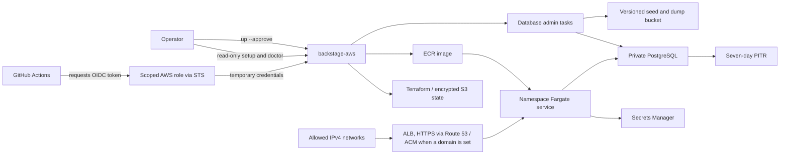

# Architecture

The Rust CLI provisions AWS resources with Terraform. GitHub Actions assumes a scoped AWS role through OIDC to deploy later pull-request previews. Node runs only in the Backstage app and its image build.

## Four Terraform stacks

| Stack | Lifetime | Owns |
|---|---|---|
| `access` | Owner-managed account setup | Scoped IAM Identity Center provisioner permission set |
| `bootstrap` | Account | State/KMS, GitHub OIDC role, workload boundary policy, optional account baseline and budget |
| `base` | Shared | VPC, ALB/TLS/DNS, ECS, ECR, RDS, secrets, seed/dump storage and admin tasks |
| `env` | Namespace | Target group, listener rule, log group, task definition and service |

`backstage-aws up --approve` runs `doctor`, `bootstrap`, `base`, optional seed and sign-in setup, environment deployment, then repository publish. It builds the first image locally. Later pull-request workflows build images in GitHub Actions. The `access` stack is separate and must already be applied by an account owner.

Shared state is stored in `<name>-<account>-<region>-tfstate`, with keys `bootstrap/terraform.tfstate`, `base/terraform.tfstate`, and `env/<namespace>.tfstate`; S3 lockfiles serialize writers. The owner-managed `access` stack is outside this state bucket and must be preserved and backed up separately.

### IAM policy source and review

Each stack keeps its IAM permission, trust, and resource policies in `policies/*.json.tftpl`. Terraform supplies explicit inputs through `templatefile`, validates the rendered JSON with `jsondecode`, and compacts it with `jsonencode`. Keep policy structure in the template; encode substitutions with `jsonencode` so strings and lists retain their JSON types.

Review permission changes in source and in a saved Terraform plan: actions, resources, principals, and conditions must all remain scoped. Apply owner-managed access changes through the `access` stack; use `backstage-aws` for bootstrap and deployment. Do not patch live IAM policies independently of their Terraform source. AWS inline-policy resources remain where already used; external JSON source does not require changing their attachment model.

## Names and data

| Selection | Namespace | Hostname (with domain) | Database |
|---|---|---|---|
| Pull request 38 | `pr-38` | `pr-38.<domain>` | `pr_38` |
| Default preview | `preview` | `preview.<domain>` | `preview` |
| Production settings | `production` | `<domain>` | `production` |

Without a domain, hostnames are `<namespace>.<name>.internal` (`<name>.internal` for `production`): host-header routing keys, not resolvable DNS names, served as HTTP on port 80 to the allowed CIDRs only.

New namespace databases clone the shared `seed` inside PostgreSQL; redeployments preserve existing databases. A seed refresh affects only future clones. There is no automatic production sync or anonymization.

## Pull-request lifecycle

Open or push → OIDC → build image and clone seed → Terraform → ECS rollout and healthy ALB target → URL comment. Only same-repository pull requests deploy; forks do not.

Closing a pull request removes its service, database and Terraform state. It does not remove the shared network, load balancer, database or registry. Per-PR runs do not cancel active applies.

The under-five-minute preview target is unmeasured and excludes GitHub queue time; cold builds can take longer. Initial shared-resource provisioning is separate and can take tens of minutes.

## Boundaries and defaults

- **Accounts:** Keep preview and production in separate accounts. Namespaces share an application database role and base secrets; they are not tenant isolation.
- **AWS identity:** Workflows use OIDC with audience `sts.amazonaws.com`; preview trust is for the repository's pull-request subjects, production trust is for `main`. No GitHub deployment Environments are used.
- **App identity:** Preview defaults to guest sign-in; production defaults to GitHub sign-in. Neither flow has been live-verified.
- **Network:** No NAT gateways by default. App tasks receive public IPs, but their security group accepts inbound traffic only from the ALB; the ALB is restricted to configured IPv4 CIDRs. RDS stays isolated. `fck-nat` or managed NAT gateways are optional and add cost.
- **Capacity:** One 1-vCPU/2-GB task per namespace; Spot is the default except production. Shared RDS defaults to `db.t4g.micro`, 20-GB gp3 storage and no Multi-AZ standby. This is a low-cost, non-HA default.
- **Budget:** The $100 monthly threshold is an alert, not a spending cap. A budget is not created unless a budget email is configured. Shared resources remain billable with no previews.
- **Recovery:** RDS automated backups/PITR retain seven days. State and seed/dump objects are versioned and encrypted; configured recovery paths have not been live-tested and are not a tested disaster-recovery service.
- **Settings:** The shell or CI loads non-secret `environments/*.env` settings; the CLI reads flags and environment variables, not the files directly. Keep secrets out of settings files.

[Quickstart](quickstart.md) · [Prerequisites](prerequisites.md) · [Settings](reference/settings.md) · [Backup and restore](guides/backup-and-restore.md).
