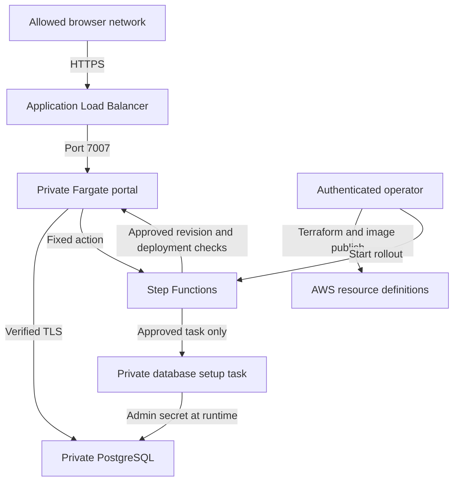

> Historical baseline evidence from the original source archive. It does not establish validation of the changed automation bundle. See docs/VALIDATION.md at the repository root for current results.

# Backstage on AWS: Fargate, Terraform, and Step Functions

A source starter for **Backstage 1.56.5** with a private ECS/Fargate service,
private PostgreSQL RDS, HTTPS, GitHub login, an explicit permission policy, and
a narrowly scoped Step Functions deployment workflow.

The application comes from the official Backstage generator and release
manifest. Infrastructure is defined with the AWS Terraform provider. A small
custom scaffolder action connects the portal to one approved workflow.

**Deployment status:** this bundle has not been applied to an AWS account.
Read `docs/VALIDATION.md` for the exact checks completed and the checks blocked
by the build environment. Run the included validation workflow before your first
AWS deployment. No example identity, domain, account, or CIDR is usable unchanged.

## What you get

| Area | Included |
| --- | --- |
| Application | Backstage 1.56.5, software catalog, search backed by PostgreSQL, software templates, GitHub sign-in |
| Network | Two availability zones; public ALB subnets, private application subnets, isolated database subnets; NAT egress |
| Runtime | One frontend/backend image, port 7007; two Fargate tasks by default; health checks and ECS deployment circuit breaker |
| Database | Encrypted RDS PostgreSQL 16, Multi-AZ by default, forced TLS, dedicated application account, 14-day backups |
| Credentials | RDS-managed administrator secret, separate application and identity secrets; no secret values in Terraform variables/state |
| Deployment | Step Functions Standard → fixed Fargate database initialization → approved ECS task revision → bounded health/stability checks |
| Authorization | Only trusted catalog identities can sign in; `platform-operators` can run the fixed rollout action; unknown permissions deny |
| Operations | Image publishing, account checks, secret upload, rollout/wait scripts, optional Rust CLI, logs, access logs, flow logs |
| State | KMS-encrypted and versioned S3 Terraform state with native lockfiles |

There is no Kubernetes, CloudFormation, Control Tower, CodeBuild, or Terraform
runner inside the portal. Terraform runs under the operator's AWS identity.
Step Functions handles activation of the already approved portal revision.
Native Node dependencies can require Python/C++ **during the dependency image
build**; those tools are excluded from the final runtime stage. There is no
authored Python deployment tool.

## Versions

| Component | Version |
| --- | --- |
| Backstage release | **1.56.5**; exact package versions from its release manifest |
| Backstage generator | 0.9.3 |
| Node / container base | 24.22.1, with the Docker base pinned by digest |
| Yarn | 4.13.0; dependency lockfile included |
| Terraform | 1.17.2 |
| AWS Terraform provider | 6.73.0; provider checksum lockfiles included |
| PostgreSQL | RDS major 16; AWS chooses an available minor version |
| Optional Rust CLI toolchain | 1.100.0; no external Rust crates |

Primary sources and existing repositories are in `docs/RESEARCH.md`. The AWS IA
ECS Blueprints Backstage example and SourceFuse ARC module are real alternatives;
the research explains where they need additional app/authentication integration.

## Architecture



The ALB is public but its security group requires explicit allowed ingress CIDRs.
The app and database have no public IP addresses. Browser-to-ALB and app-to-RDS
traffic use TLS. ALB-to-app traffic is HTTP inside the VPC, restricted by security
groups. Outbound HTTPS goes through NAT for GitHub and AWS APIs.

## Before you start

Use Linux, macOS, or WSL2 with:

- AWS CLI v2 authenticated with short-lived credentials in the intended account.
- Terraform **1.17.2**.
- Node **24.22.1** for the small configuration checks and secret-file generator.
- Docker with BuildKit and the ability to build `linux/amd64` images.
- Bash and `jq`.
- Enough local memory and disk for Backstage's dependency/build graph; this is a
  large TypeScript application even with optional plugins removed.

The deployment image build runs Yarn, TypeScript, and native compiler prerequisites
inside Docker. You do not need to install Python/C++/libsecret headers on your
workstation. Running the optional host application validation commands does require
those native build prerequisites and Corepack; CI installs them explicitly.

You also need an existing **public Route53 hosted zone with working delegation**,
a hostname under that zone, your corporate/VPN public egress CIDR, a GitHub OAuth
application, and your GitHub numeric user ID. The initial Terraform identity must
be allowed to create the resources declared under `infra/`; the narrow runtime
roles do not supply infrastructure provisioning permissions. Existing organization
SCPs, quotas, permission boundaries, and DNS delegation can still block an apply.

This source targets a commercial AWS region and `github.com`. Adapt and test the
ARN validation/endpoints/auth configuration before using other partitions or
GitHub Enterprise.

## First deployment

### 1. Set the AWS account, domain, and network access

From this directory:

```sh
cp infra/bootstrap/terraform.tfvars.example infra/bootstrap/terraform.tfvars
cp infra/core/terraform.tfvars.example infra/core/terraform.tfvars
```

Edit both files. Use the same `aws_account_id`, `aws_region`, and `name` in both.
Choose a unique `name` for each deployment in an account, including deployments
in different regions, because IAM role names are account-wide.
In the core file, also set `domain_name`, `route53_zone_id`, and
`allowed_ingress_cidrs`. The example `203.0.113.10/32` is a documentation address;
replace it with your actual corporate/VPN public egress range. Use
`0.0.0.0/0` only as an explicit decision to make the endpoint internet-wide.

Leave `image_digest = null` for the first infrastructure apply. The workflow
rejects rollouts until a real image digest is registered. Scripts verify that
your AWS CLI account matches the provisioned stack. Terraform providers also
enforce the configured account ID.

### 2. Set the initial trusted identity

Find your numeric ID using GitHub's public API:

```sh
curl -fsSL https://api.github.com/users/YOUR_GITHUB_LOGIN | jq -r .id
```

Edit `app/catalog/org.yaml`, replacing the placeholder with your actual ID as a
**quoted YAML string**, for example:

```yaml
annotations:
  github.com/user-id: "12345678" # Replace with your actual numeric ID.
```

Keep this User in `platform-operators`. The publishing script refuses to build
with the placeholder. Additional users need distinct catalog User entities and
their real numeric IDs. Group membership is managed through this trusted source;
users cannot grant themselves permissions through the catalog API.

### 3. Provision the AWS resources

```sh
./scripts/provision.sh
```

Terraform presents plans for approval. The script creates the state bucket/key,
migrates bootstrap state to `bootstrap/terraform.tfstate`, initializes the core
state backend, and applies the infrastructure. The ECS service remains at zero
tasks; it does not try to pull a nonexistent image or start without credentials.

Keep `infra/core/backend.local.hcl`, the two edited tfvars files, and the generated
`infra/bootstrap/backend.local.tf` with your private deployment configuration.
These files are ignored by Git. Restore backend configuration before operating an
existing stack from another machine; do not create a second local state for the
same deployment. The migration prompt copies existing state—it does not recreate
the resources. The script verifies that the migrated state is readable before
initializing core. If migration is declined or interrupted, recover that migration
before retrying; the script stops instead of blindly applying against empty state.
`infra/bootstrap` protects its state bucket and KMS key from destroy.

### 4. Configure GitHub OAuth and store the identity secret

Create an OAuth App in your organization's GitHub developer settings:

| Setting | Value |
| --- | --- |
| Homepage URL | `https://YOUR_PORTAL_HOSTNAME` |
| Authorization callback URL | `https://YOUR_PORTAL_HOSTNAME/api/auth/github/handler/frame` |

Create an ignored local directory and generate a secret template:

```sh
mkdir -p .secrets
chmod 700 .secrets
node -e 'const fs=require("node:fs"),c=require("node:crypto");fs.writeFileSync(".secrets/github-identity.json",JSON.stringify({clientId:"REPLACE",clientSecret:"REPLACE",sessionSecret:c.randomBytes(48).toString("base64url")},null,2),{mode:0o600,flag:"wx"})'
```

Edit `clientId` and `clientSecret` with the values from GitHub. Leave the generated
session secret intact. Upload it:

```sh
./scripts/set-identity.sh .secrets/github-identity.json
```

The script passes a file reference to Secrets Manager, not the secret text in a
process argument or Terraform variable. Remove the local credential file after
storing it in your normal secret-management process. Do not commit it. The backend
does not need a personal access token or repository write permission for this
initial catalog and rollout template.

### 5. Build, publish, and deploy

```sh
./scripts/deploy.sh
```

The script first checks that the identity secret has a current version without
reading its contents. The Docker build installs the lockfile, compiles and tests
the app, builds its backend bundle, and creates the runtime image. The script pushes it to this
stack's ECR repository, and resolves the immutable image digest. It writes that
digest to ignored `infra/core/image.auto.tfvars.json`, runs `terraform apply` to
register the approved task revisions/workflow, and starts the rollout workflow.
The apply explicitly selects the just-published digest file, and the script
compares the approved digest with that file before starting Step Functions.

Step Functions runs the fixed database job first. That job obtains the
RDS-managed admin credential at runtime, stores a separate random application
credential if absent, and creates the restricted application role. Rerunning it
reuses the existing app secret. It then activates the selected portal revision
and waits for the **same deployment ID** to finish with the requested healthy
task count. A rollback or unrelated deployment cannot satisfy its success check.

The script prints the execution ARN and, on success, the portal URL. Log in with
the trusted GitHub identity. The catalog must process the local User/Group before
sign-in can resolve it; if the first login immediately after startup fails, inspect
catalog logs and retry after processing completes.

## Everyday operations

**Application/code update:** change source and run `./scripts/deploy.sh` with a
new unique image tag if desired. ECR tags are immutable. Terraform owns task
definitions; Step Functions owns the active service revision and desired count.
Changing task definitions in Terraform alone does not activate them.

**Redeploy existing approved image:** run `./scripts/rollout.sh` or use the portal's
rollout template as a platform operator. The template returns an AWS execution
link immediately because the workflow replaces the portal tasks. An accepted
scaffolder request is not a claim that the deployment succeeded; check Step
Functions status. Run one operator deployment at a time.

**Infrastructure-only change:** run `terraform -chdir=infra/core plan` and
`terraform -chdir=infra/core apply`. If the change affects task configuration,
follow it with `./scripts/rollout.sh`.

**Rollback:** set `image_digest` to a previously retained ECR digest in
`infra/core/image.auto.tfvars.json`, review/apply Terraform, then run the rollout.
The circuit breaker can also restore a previous healthy ECS deployment. A
container rollback does not undo database schema migrations; inspect Backstage
release/plugin migration compatibility before downgrading.
Portal task definitions are deliberately retained with `skip_destroy = true` so
older revisions remain available. Retire obsolete revisions explicitly after your
rollback window and retention policy permit it.

**Identity-secret changes:** upload the new JSON and roll out. Injected ECS
environment values are loaded at task startup. The app database secret is not
automatically rotated by this starter; changing its value requires a coordinated
database reconciliation and service rollout. The separate RDS administrator
secret remains managed by RDS.

**Inspect logs:** CloudWatch groups are `/backstage/NAME/portal`,
`/backstage/NAME/db-bootstrap`, `/backstage/NAME/vpc-flow`, and
`/aws/vendedlogs/states/NAME-rollout`. ALB access logs are stored in the dedicated
S3 bucket. Workflow error logs exclude execution payloads.

## Optional Rust operator helper

The shell scripts are sufficient. If you prefer the small Rust wrapper:

```sh
cd tools/portalctl
cargo build --release --locked
./target/release/portalctl --help
./target/release/portalctl doctor
./target/release/portalctl rollout us-east-1 YOUR_STATE_MACHINE_ARN my-unique-request
./target/release/portalctl status us-east-1 YOUR_EXECUTION_ARN
```

It uses AWS CLI credentials, validates identifiers, never invokes a shell, and
bounds child execution. It does not apply Terraform, build images, or store
credentials. Reuse a request ID only to reconcile the same intended request;
closed Standard executions reject name reuse. The helper's tests and limitations
are recorded in `tools/portalctl/VALIDATION.md`.

## Cost and availability choices

Defaults favor resilience: two portal tasks, two NAT gateways, and Multi-AZ RDS.
For a disposable pilot, explicitly set:

```hcl
portal_desired_count = 1
single_nat_gateway  = true
database_multi_az   = false
```

That reduces fixed resource count and availability. The portal task uses 1 vCPU
and 4 GiB by default; database class is `db.t4g.small`. ALB, NAT, database, logging,
storage, and public IPv4 addresses all add charges even with little portal traffic.
Use the AWS Pricing Calculator for your selected region and traffic volume.
No savings or load-capacity guarantee is implied by these starting sizes.

## Validation and extensions

Run `.github/workflows/validate.yml` in your repository. It has read-only GitHub
permissions and no AWS credentials. It validates Terraform, runs mock security
assertions, tests/compiles Backstage, builds the runtime image, checks runtime
bootstrap imports, and tests the optional Rust helper. See `docs/VALIDATION.md`
for which of these checks actually ran while preparing this source.

Security controls and limits are documented in `docs/SECURITY.md`. The first
future extension should be whichever provides immediate value—repository
discovery, ECS catalog views, or a separate approved service-deployment workflow.
Each new scaffolder action needs an explicit policy and narrowly scoped AWS role.
Do not turn the portal into an administrator shell by accepting arbitrary module
URLs, commands, image names, state-machine ARNs, or IAM roles from a form.

## Teardown

This is deliberately not a single destructive cleanup command. Disable ALB/RDS
deletion protection in the reviewed configuration first. Preserve a usable RDS
snapshot, account for the fixed final-snapshot name on repeated deployments, and
archive needed ECR images/logs before emptying their protected buckets/repository.
Secrets have recovery windows. The remote state bucket, its KMS key, and the
application KMS key have Terraform `prevent_destroy`. Keep the application key
enabled for as long as any RDS snapshot, backup, secret, or log encrypted with it
is retained; a pending-deletion key can make those records unusable immediately.
Move retained keys into a separately managed retention stack before removing
the core stack, or keep the protected resources under this state. Retain the state
key/bucket until the environment is fully removed and its history archived.
Follow your normal infrastructure decommissioning process.

